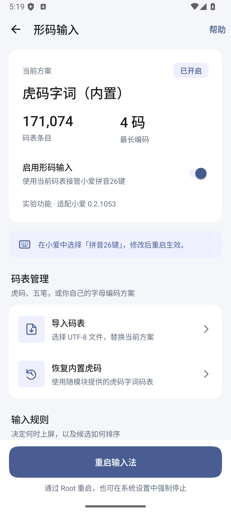
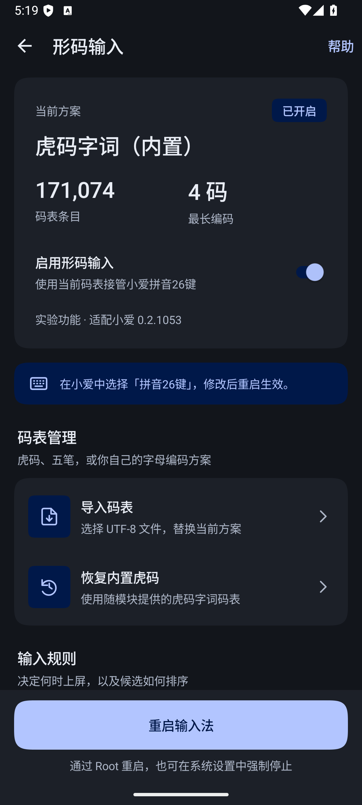

# 形码输入原型 1

本原型在模块内增加码表引擎。2.1.6.1 起提供独立的「虎码/五笔」键盘选项，内置虎码字词，可替换成五笔等静态码表；「拼音26键」保留原生拼音。界面、横竖屏布局、候选栏继续由小爱提供。

截至 2026-10-13，完成源码实现、桌面单元测试和安装包构建，**尚未完成真机接入验证**。不是已确认能日常使用的版本，也不代表官方在开发形码。

## 使用

1. 安装原型模块，在 LSPosed 中启用模块并勾选超级小爱输入法。原型使用与主模块相同的应用 ID；覆盖安装要求签名一致。未提供正式签名配置时，原型使用开发签名。
2. 打开模块首页「形码输入 · 虎码 / 五笔（实验）」，打开「在键盘选择中显示虎码/五笔」。新安装默认显示，升级继承旧开关状态。首次使用自动准备内置虎码。
3. 按需要调整规则，然后重启输入法。页面的重启按钮沿用模块已有的 Root 重启功能，也可自行强制停止并重新打开输入法。
4. 在小爱「键盘选择」或设置页「键盘类型」中选择「虎码/五笔」，在普通文本框输入 `jx 空格 bh 空格`，预期上屏「你好」。
5. 返回形码设置页查看运行结果。显示「形码引擎已接入」仅表示代理已创建；「已收到形码输入」仅表示收到按键，不能代替核对编辑框输出。
6. 导入五笔时选择 UTF-8 码表，输入方案名称。新码表替换当前表；可用「恢复内置虎码」恢复。每次修改均需重启输入法。
7. 在小爱中直接选「拼音26键」恢复原拼音，也可切到18键；切换无需重启。模块开关只控制入口显示，隐藏当前选择后重启回退到原生拼音。

仅针对 `com.xiaomi.type` **versionCode 21053 / 0.2.1053.06f65b7c**。其他版本不启用替换。该版本的宿主 APK SHA-256：`c7e1e9d73fc515bb087e3677288b4de64110b5191d913d1d6c9757b3c1b5563b`。

## 设置页界面

形码设置页采用方案卡片、分组设置项和固定底部重启按钮。当前方案、条目数和最长编码集中展示；码表管理、输入规则、快捷选词和运行状态分别分组，完整格式说明放入「帮助」。设置更新保留滚动位置，有未应用更改时提示「重启并应用更改」。

沿用模块的蓝色与中性底色，支持系统深浅色，Android 12 起使用壁纸强调色。卡片使用平滑圆角，触控区不小于 48dp，文本容器随内容和字体放大伸展，内容在平板宽度限制为 720dp 并居中。

  
  

静态兜底配色对比度：次要正文与卡片底色浅色 5.31:1、深色 8.00:1；提示文字与强调底色 6.02:1 / 7.23:1；主按钮文字与底色 4.83:1 / 8.84:1。Android 12 以上使用系统强调色阶。

已在 Android 16 / API 36 模拟器查看浅色、深色、200% 字体和加载、码表读取失败状态；验证启用开关、未应用更改提示、规则切换时保留滚动位置，以及最大码长选择弹窗。上述截图来自实际运行的模块页面，不代表宿主形码输入已经验证。

## 支持的数据和规则

支持小写 `a–z` 编码、1–8 码，UTF-8 文本最多 32 MiB / 50 万条。每行推荐「文字 TAB 编码 TAB 可选权重」，也支持「编码 TAB 文字」。当两列都是小写英文时，按文字在前解释。支持 Fcitx5 `[Data]` 段，以及 Rime `.dict.yaml` 的实际条目及 `columns` 声明；不展开 `import_tables`，不执行 schema、Lua 或组词规则。跳过无效行和去重数量会在导入后显示。

默认保留码表顺序，可改为按权重降序，同权重保持原顺序。精确查码，不扫描全文，不作拼音纠错。

| 操作 | 行为 |
| --- | --- |
| 空格 | 编码中提交首选；无候选时提交原编码 |
| 点击候选 | 按原生候选栏对应索引提交，支持分页 |
| 1–9 | 编码中选择第 1–9 项，可关闭；索引不存在时保留编码 |
| 半角分号、单引号 | 编码中选第 2、3 项，可分别关闭；无对应候选时提交首选或原编码，再输出标点 |
| 达到最大码长 | 唯一候选可自动提交，可关闭 |
| 满码后继续字母 | 可顶屏首选或原编码，再开始新编码；关闭顶屏时保留满码并拦住后续字母 |
| 退格 | 删除一位编码；编码为空时交给宿主处理 |
| Shift、回车、布局切换 | 沿用宿主行为；其中回车沿用原始编码提交语义 |

首版没有动态学习、自造词、拼音反查、混输、Rime 脚本和字根键帽。T9、双拼、手写、英文引擎不被替换。全角分号不等同于半角分号快捷选词。

## 接入和存储

- `ShapeInputHook` 拦截 `ab.x0.b(z8.g)`，仅在宿主选中「虎码/五笔」、入口可见且版本匹配时替换 PINYIN 实例；载入失败继续调用原工厂。选择集成与迁移见[独立键盘选择接入记录](2026-10-15_逆向-独立键盘选择-report.md)。
- `ShapeHostBridge` 校验并实现 `z8.q` / `z8.p` 共 24 个方法，转换宿主候选、组合状态、输入结果和选词结果。保留 PINYIN 类型以复用布局。
- `ShapeHostKeyAdapter` 在 `ab.f1.c(ka.c, ab.b1)` 内，仅处理本模块会话中的原始编码及支持的选词按键，绕过拼音触点纠错与该路径的学习记录。其他控制交给宿主。
- 本模块会话不执行 `ab.s0.l(z8.q)` 的拼音日期、时间和计算器候选扩展。
- 码表在模块内校验后以 `AtomicFile` 保存二进制快照。宿主通过只读 Provider 文件流加载，避免大码表超过 Binder 单次传输限制。Provider 仅允许模块自身及宿主 UID 调用。设置、码表位于设备保护存储，设置版本用于拒绝过期状态报告。
- 启用后的码表在进程内共享，各引擎实例独立保存编码；修改需重启。输入内容不写入形码状态报告。

## 内置码表来源

采用 [lvyww/tiger-code](https://github.com/lvyww/tiger-code/tree/3e1bff2f757806152ef5b701c709c24f54cf800f) 的 `tables/tiger.txt`，CC0-1.0，固定提交 `3e1bff2f757806152ef5b701c709c24f54cf800f`。保留条目顺序，去除文件头，转为 UTF-8 TSV，并以确定性的 gzip 打包。共 **171,074** 条，最大 4 码。

原始文件 SHA-256：`36e16b76d66f4f5be2341396e8eb400e44244d528823a5eabb4e90c9c5c1de24`。来源及许可随 APK 包含在 `assets/shape/`；不包含上游标志或图案。gzip 内容使用 `tiger.table` 文件名，避免 AAPT 自动展开 `.gz` 并改名。

重建：`python scripts/update-tiger-table.py`。离线复现可传入 `--source-dir`，目录内提供该版本的 `tiger.txt` 和 `LICENSE`。

## 验证与待测

构建：`gradlew.bat :app:assembleShapePrototype`。测试：`gradlew.bat :app:testDebugUnitTest`。

17 项形码单元测试通过：真实虎码完整解析和二进制往返、「你好」输入、五笔表输入、顶屏连续提交、规则关闭、空码保留、退格、重建、权重稳定排序、Rime/Fcitx5 导入、无效输入，以及宿主接口替身中的分页、选词、生命周期、按键回调和透传。接口替身不等于宿主运行验证。

另用 `python scripts/verify-shape-host.py <apktool解包目录>` 对实际宿主 smali 检查 24 个方法、构造函数、原始字段名及 Hook 签名，通过。`python scripts/verify-shape-apk.py <原型APK>` 验证 APK 内码表实际路径、gzip 编码、条目及许可，防止资源打包步骤改变文件格式。

全项目 Lint 检查仍有 28 个已有错误，集中在原外观 Hook 的 Android API 兼容性、常量和私有 API，以及模块入口已有 API 调用；形码新增文件没有 Lint 错误。没有通过新增 baseline 隐藏错误。

未连接含目标输入法的真机。模块设置页已用模拟器验证，宿主输入链路仍需真机检查：代理加载与 Provider 权限、字母/空格上屏、点击及展开候选、无候选退格、输入框切换及光标移动、中英文和符号切换、横竖屏、平板分离布局、工具栏/AI 面板切换，以及键盘反馈和延迟。出现异常可关闭开关并重启，或在 LSPosed 禁用模块。
